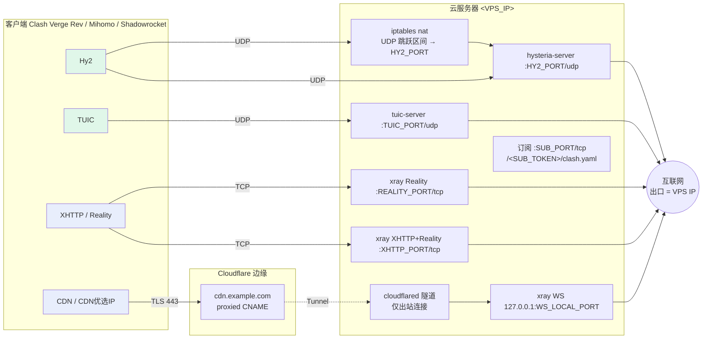

# oracle-vpn-kit

> **AI agents: read [AGENTS.md](AGENTS.md) first.** 让 AI 代你部署：把本仓库交给它，它会先只读出计划，你批准后一条命令完成部署。

在 **甲骨文云（Oracle Cloud）Always Free** 免费云服务器（Ubuntu）上自建**个人** VPN 的方案与脚本包。
多协议并存，UDP 为主、Cloudflare CDN 兜底，适合「家宽对 VPS IP 的 TCP 不通、UDP 能通」这类网络环境。

> 本仓库只有模板和占位符，不含任何真实 IP、域名、密码、密钥或订阅地址。
> 真实凭据只放在你本地的 `.env`（已 gitignore）和你自己的服务器上。

## 特点

- **多协议互为备份**：Hysteria2（混淆 + 端口跳跃）、TUIC v5、VLESS+WS 经 Cloudflare 隧道、XHTTP+Reality、Reality+Vision。
- **不用网页面板、不跑 `curl | bash`**：每一步都是可读的小脚本；核心程序只从官方 Release 下载，并按官方校验文件验证 sha256。
- **`.env` 驱动、可重复执行**：随机生成全部凭据和端口；脚本幂等，改文件前自动备份为 `*.bak-时间戳`。
- **一键部署**：`deploy.sh` 默认只打印计划（不改任何东西），批准后一条命令按顺序跑完全部脚本；失败即停并给出续跑命令，重复执行安全。
- **一键健康检查、升级、卸载**：`status.sh` 只读体检（PASS/WARN/FAIL）；`update.sh` 校验后升级、失败自动回滚；`uninstall.sh` 只删本工具加的东西，支持 `--dry-run`。
- **三种客户端格式**：Clash/Mihomo 订阅、sing-box 配置、Shadowrocket/v2rayN 分享链接（含 Base64 订阅和二维码）。Reality 节点请用 Mihomo 或 Xray 内核客户端（sing-box 上游与新版 Xray 的 REALITY 不兼容，见 docs/03）。
- **x86_64 与 ARM（Ampere A1）** 都支持；另附可选的 Docker 方案。
- 自带 CI：shellcheck、语法检查、假凭据自测、脱敏扫描。

## 从零开始（按顺序看）

1. **拿到免费服务器** → [docs/01_免费服务器_甲骨文云.md](docs/01_免费服务器_甲骨文云.md)（注册、选主区域、信用卡验证、建实例、公网 IP、安全列表、闲置回收）
2. **拿到免费域名并接入 Cloudflare**（只有 CDN 节点需要）→ [docs/02_免费域名_DigitalPlat与Cloudflare.md](docs/02_免费域名_DigitalPlat与Cloudflare.md)
3. **部署** → 下文「快速开始」，原理与排障见 [docs/方案.md](docs/方案.md)
4. **客户端使用**（Clash Verge Rev / Shadowrocket / sing-box / CloudflareST 优选 IP）→ [docs/03_客户端使用.md](docs/03_客户端使用.md)
5. **注意事项与运维**（凭据、续期、回收、换 IP、隐私、升级、回滚、卸载）→ [docs/04_注意事项.md](docs/04_注意事项.md)

## 节点一览（推荐顺序）

节点名前缀由 `.env` 的 `NODE_PREFIX` 决定（默认 `MyVPN`）；端口均为 `.env` 变量，`scripts/gen_secrets.sh` 会随机生成。

| 顺序 | 节点 | 协议 | 端口 | 说明 |
|---|---|---|---|---|
| 1 | MyVPN-Hy2 | Hysteria2 + salamander 混淆 + 端口跳跃 | UDP `HY2_PORT`，跳跃 `HY2_HOP_START`-`HY2_HOP_END` | TCP 被封时首选 |
| 2 | MyVPN-TUIC | TUIC v5（h3, bbr） | UDP `TUIC_PORT` | UDP 备选 |
| 3 | MyVPN-CDN-1..N | VLESS+WS+TLS，入口为 Cloudflare 优选 IP | TCP 443（Cloudflare） | TCP 兜底，入口在 CF 边缘，出口仍是 VPS |
| 4 | MyVPN-CDN | 同上，入口为自有域名 | TCP 443（Cloudflare） | 不依赖优选 IP |
| 5 | MyVPN-XHTTP | VLESS+XHTTP+Reality | TCP `XHTTP_PORT`（默认 443） | VPS IP 直连 |
| 6 | MyVPN-Reality | VLESS+Reality+Vision | TCP `REALITY_PORT` | VPS IP 直连 |

## 架构



## 快速开始

### 方式一：一键部署（推荐）

```bash
# 服务器上：
git clone <本仓库地址> && cd oracle-vpn-kit
bash scripts/deploy.sh --plan --set VPS_IP=<公网IP> --set REALITY_SNI=<伪装站点> --set HY2_SNI=<证书名>
#   只读：显示组件、脱敏配置、预检结果和每一步是否修改系统；退出码 0=可执行，2=预检有 FAIL
sudo bash scripts/deploy.sh --yes --set VPS_IP=<公网IP> --set REALITY_SNI=<伪装站点> --set HY2_SNI=<证书名>
#   不用 CDN：加 --skip cdn；只装部分：--only hy2,hop,sub
#   用 CDN：再加 --set CF_TUNNEL_NAME=<隧道名> --set CDN_DOMAIN=<你的子域名>，并在终端里由你本人打开 Cloudflare 授权链接
```

完成时会打印 `结果：PASS n  WARN m  FAIL 0`、客户端文件路径（`out/`）和需要在云控制台安全列表放行的 TCP/UDP 端口。
`.env` 不存在时会自动生成（权限 600，已有值永不覆盖）；日志在 `/var/log/oracle-vpn-kit/`（不含秘密）。
中途失败会停在出错那一步，并打印续跑命令（`--only <剩余组件>`）。

### 方式二：手动逐步

```bash
# 服务器上：
git clone <本仓库地址> && cd oracle-vpn-kit
chmod +x scripts/*.sh tools/*.py          # 网页上传的仓库可能丢失可执行位，补一下
cp .env.example .env && vi .env           # 填 VPS_IP、VPS_IFACE、REALITY_SNI、HY2_SNI、CF_TUNNEL_NAME、CDN_DOMAIN 等
bash scripts/gen_secrets.sh               # 生成 UUID/密码/路径/随机端口（只填空值）
# 按 .env 里生成的端口，在 OCI 控制台安全列表放行（见 docs/方案.md「OCI 安全列表」）
sudo bash scripts/prepare_host.sh         # BBR、swap、iptables-persistent
sudo bash scripts/install_xray.sh         # 首次会装好 xray 后因缺 Reality 密钥退出 ↓
bash scripts/gen_secrets.sh               # 有了 xray 再跑一次，补 Reality 密钥对
sudo bash scripts/install_xray.sh
sudo bash scripts/install_hysteria2.sh
sudo bash scripts/setup_port_hopping.sh
sudo bash scripts/install_tuic.sh
sudo bash scripts/install_cloudflared_tunnel.sh   # 需要你本人打开授权链接
python3 tools/gen_subscription.py         # 生成 Clash / sing-box / 分享链接 / 二维码到 out/（已 gitignore）
sudo bash scripts/serve_subscription.sh   # 发布订阅
sudo bash scripts/status.sh               # 体检：全部 PASS 即完成
```

所有脚本**只在你手动执行时**作用于当前服务器；可重复执行（幂等），修改前会自动备份为 `*.bak-时间戳`。

订阅地址（真实值自己拼，当密码保管）：`http://<VPS_IP>:<SUB_PORT>/<SUB_TOKEN>/` 后接 `clash.yaml`（Clash Verge Rev / Mihomo）、`sing-box.json`（sing-box）或 `v2ray.txt`（Shadowrocket / v2rayN）。

## 日常维护

```bash
sudo bash scripts/status.sh                 # 只读健康检查（--quiet 只看问题，--no-net 跳过 CDN 检查）
sudo bash scripts/update.sh --check         # 查看各核心当前/最新版本
sudo bash scripts/update.sh xray            # 升级单个核心：xray | hy2 | tuic | cloudflared | all
sudo bash scripts/uninstall.sh --dry-run    # 预览卸载会做什么；去掉 --dry-run 执行，--purge 连文件一起删（先备份）
bash tools/selftest.sh                      # 用假凭据自测生成器（可选 mihomo / sing-box 校验）
python3 tools/scan_repo.py                  # 提交前脱敏扫描
```

换了 `.env` 里的任何值（IP、密码、优选 IP……）：重跑对应的 `install_*.sh` → `gen_subscription.py` → `serve_subscription.sh` → 客户端先切直连再更新订阅。升级、回滚、卸载细节见 [docs/04_注意事项.md](docs/04_注意事项.md#运维升级与回滚)。

## 目录

```
AGENTS.md                    给 AI 代理的操作手册（询问清单、权限闸门、步骤、回滚、排障、机器可读 YAML）
.env.example                 全部变量与说明（复制为 .env）
docs/01_免费服务器_甲骨文云.md      免费服务器：注册、建实例、IP、防火墙、回收
docs/02_免费域名_DigitalPlat与Cloudflare.md 免费域名与 Cloudflare 托管
docs/03_客户端使用.md                Clash Verge Rev / Shadowrocket / CFST 优选 IP
docs/04_注意事项.md                  注意事项汇总
docs/方案.md                  完整方案：原理、部署、排障、回滚、安全
scripts/lib.sh               公共函数（渲染模板、备份、防火墙、持久化）
scripts/deploy.sh            一键部署编排（默认 --plan 只读；--yes 执行）
scripts/gen_secrets.sh       生成随机凭据与端口写入 .env
scripts/prepare_host.sh      BBR、swap、基础包
scripts/install_xray.sh      Xray 三入站（官方 Release + sha256）
scripts/install_hysteria2.sh Hysteria2 + 自签证书 + 混淆（官方 Release + sha256）
scripts/setup_port_hopping.sh Hy2 端口跳跃（iptables nat）
scripts/install_tuic.sh      TUIC v5（sha256 校验）
scripts/install_cloudflared_tunnel.sh Cloudflare 命名隧道 + CNAME
scripts/serve_subscription.sh 订阅静态服务（秘密路径，换 token 自动撤销旧地址）
scripts/status.sh            只读健康检查（PASS/WARN/FAIL）
scripts/update.sh            升级核心（sha256 校验、自动回滚）
scripts/uninstall.sh         卸载（--dry-run / --purge）
templates/                   服务端配置、systemd、Clash 模板、分享链接格式
tools/gen_subscription.py    由 .env 生成 Clash、sing-box、分享链接、二维码
tools/selftest.sh            假凭据自测
tools/scan_repo.py           脱敏扫描
docker/                      可选：Docker 方案（host 网络）
.github/workflows/lint.yml   CI：shellcheck / bash -n / py_compile / 自测 / deploy --plan 不改动检查 / 脱敏扫描
CHANGELOG.md                 更新记录
LICENSE                      MIT
```

## 许可证

[MIT](LICENSE)

## 免责声明

仅供个人学习与日常浏览使用。请遵守你所在地的法律法规以及 Oracle Cloud、Cloudflare 等服务商的条款。
